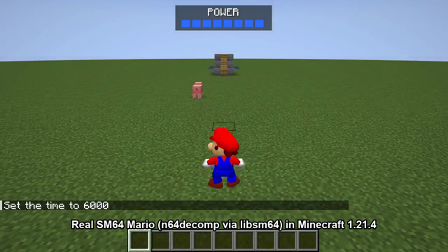

# Mario 64 in Minecraft

Play as the **real Super Mario 64 Mario** in Minecraft Java 1.21.4 (Fabric). Mario's movement isn't an imitation: it's
the decompiled game code from [n64decomp/sm64](https://github.com/n64decomp/sm64) (`mario.c`, `mario_actions_*.c`,
`mario_step.c`, surface collision, animations), compiled into a native library through
[libsm64](https://github.com/libsm64/libsm64). Mario's model, textures, animations and sounds are loaded at runtime from
**your own** SM64 ROM. This repository contains no Nintendo assets.

 · clip: [`showcase/mario64_in_minecraft.mp4`](showcase/mario64_in_minecraft.mp4)

## What works (verified in game)
- Verified by the automated tests: run, single/double/triple jump, **long jump** (14.5 blocks), **wall kick**,
  **backflip** and **side flip** (4.5 blocks each, both launch at SM64's vel.y 62), **slide kick**, ledge grab and climb,
  punch, move-punch, dive, ground pound, water plunge and swimming (breaststroke and flutter), and knockback.
- Minecraft blocks become SM64 collision around Mario every tick. Straight stairs become SM64-style non-slippery
  ramps, slabs and carpets are step-ups, ice is SM64 ice (slippery), and lava and magma are `SURFACE_BURNING`
  (lava boost "yeowch" jump). Soul sand is shallow quicksand. Footstep sounds follow the block (grass, stone, snow,
  sand, wood).
- Minecraft water sets SM64's water level, so Mario really swims.
- Punches, kicks, dives and ground pounds damage mobs, and landing on a mob stomps it and bounces Mario (Goomba-style).
- SM64's power meter mirrors your hearts. Taking damage plays Mario's knockback.
- Mario's voice and SFX come from SM64's own sound engine (32 kHz, from the ROM).

## Controls
| Key | SM64 |
|---|---|
| **M** | Toggle Mario on/off (rebindable under Controls → Mario 64) |
| WASD | Analog stick, relative to the camera |
| Space | A (jump / swim) |
| Left click | B (punch, kick, dive) |
| Shift | Z (crouch, ground pound, long jump with A, backflip) |
| Mouse | Camera (third person) |

## Install (Windows)
1. Install Fabric Loader 0.16.10 for 1.21.4 and Fabric API 0.119.4+1.21.4.
2. Put `mario64mc-0.1.0.jar` in `mods/`.
3. Put `sm64.dll` (built below) and your own ROM, renamed to `baserom.us.z64` (US release, SHA1 `9bef1128717f958171a4afac3ed78ee2bb4e86ce`), in `<game dir>/config/mario64/`.
4. In a single-player world, press **M**.

## Build
- `sm64.dll`: clone libsm64, then run `python import-mario-geo.py` (it fetches Mario's geo/model sources from n64decomp/sm64), then `make lib CC=gcc` with w64devkit/MSYS2 gcc.
- Mod: `cd mod && ./gradlew build` (JDK 21) produces `mod/build/libs/mario64mc-0.1.0.jar`.
- Automated in-game tests: `./gradlew runAutotest` (hills: moves), `runCourse`, `runShow` (flat course), `runTech`
  (long jump and wall kick) and `runFlips` (backflip, side flip, slide kick). The last two end with a
  `RESULT …=PASS|FAIL` line. Each opens a
  lab world, becomes Mario, drives scripted controller input, logs `MARIO64TEST` state lines (SM64 action IDs,
  positions, mob HP) and saves screenshots to `mod/run/screenshots`.

## Limitations
- Single-player only. In multiplayer, other players see Steve and the server checks your movement against Steve's hitbox.
- Only the US ROM has been tested. Windows only for now (libsm64 also builds on Linux and macOS; load `libsm64.so` / `.dylib`).
- Curved and complex block shapes are approximated by their collision boxes.

## Credits
- The n64decomp team, for the SM64 decompilation.
- libsm64 (jaburns and contributors).
- FabricMC.
- Built by Claude (Anthropic AI) with Zckyy.
