# Mario 64 in Minecraft

**Play as the real Super Mario 64 Mario inside Minecraft Java Edition.** This isn't a look-alike model or a set of
imitation moves. Mario's movement code is the actual decompiled game code from
[n64decomp/sm64](https://github.com/n64decomp/sm64), running through [libsm64](https://github.com/libsm64/libsm64)
inside a Fabric mod. Minecraft's blocks become SM64 collision around him in real time, and his model, animations, voice
and the original soundtrack are loaded from **your own** Super Mario 64 ROM.

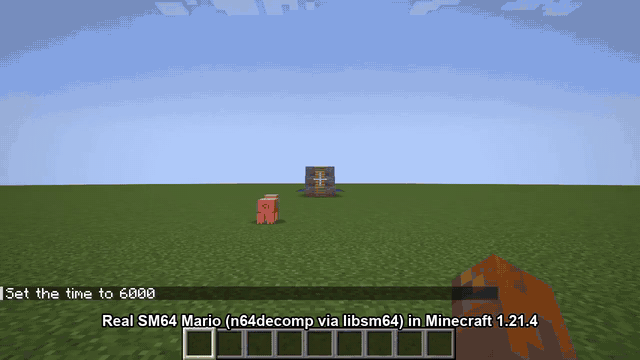

<sub>One automated test run: triple jump → stairs → stomp → dive → swim. MP4: [`docs/media/showcase.mp4`](docs/media/showcase.mp4)</sub>

> [!IMPORTANT]
> **No Nintendo content is included in this repository or its releases.** You need your own *Super Mario 64 (USA)* ROM.
> `sm64.dll` (compiled from the decompilation) isn't distributed either: you build it with one script (below).

---

## Contents
- [Features](#features)
- [How it works](#how-it-works)
- [Requirements](#requirements)
- [Installation](#installation)
- [Controls](#controls)
- [Settings](#settings)
- [Shaders](#shaders)
- [Building from source](#building-from-source)
- [Automated in-game tests](#automated-in-game-tests)
- [Troubleshooting](#troubleshooting)
- [Limitations](#limitations)
- [Project layout](#project-layout)
- [Credits and license](#credits-and-license)

---

## Features

### The real SM64 moveset
Every move comes from the original game logic (`mario_actions_*.c`), so it has the same speeds, timings and heights as on
the N64.

| Long jump + wall kick | Backflip, side flip, slide kick |
|---|---|
| 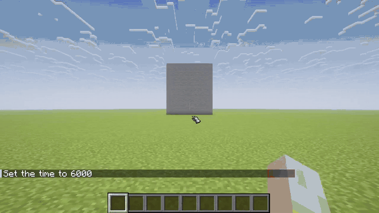 | 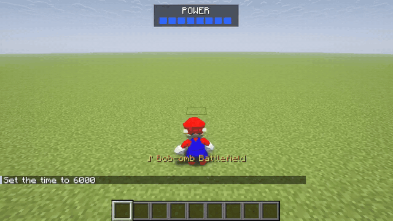 |

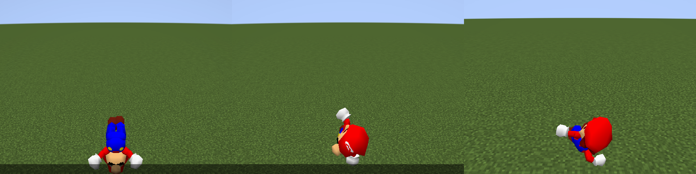

Verified in game by automated tests (see [below](#automated-in-game-tests)):
- **Movement:** walking and running (true analog: a half stick walks at about 8, a full stick runs at about 32).
- **Jumps:**
  - single, double and **triple jump** (+6 blocks);
  - **long jump** (14.5 blocks);
  - **backflip** and **side flip** (4.5 blocks; both launch at SM64's vertical speed of 62);
  - **wall kick**.
- **Climbing:** ledge grab and ledge climb.
- **Attacks:** punch, move-punch, slide kick, dive and **ground pound**.
- **Water:** water plunge and **swimming** (breaststroke and flutter kick), using SM64's swimming model.
- **Damage:** knockback reactions, plus SM64 fall damage when landing from a great height.

### Minecraft blocks become SM64 levels
- Each tick, the blocks around Mario are turned into SM64 collision triangles: floors, walls and ceilings, exactly the
  data SM64's collision code expects.
- **Stairs** become 45° non-slippery ramps, which is how SM64 builds its staircases.
- Slabs, carpets and snow layers are step-ups.
- **Surface types:**
  - Ice is SM64 ice (slippery).
  - Lava and magma are `SURFACE_BURNING`, giving the "yeowch!" lava-boost jump.
  - Soul sand is shallow quicksand.
- **Water:** Minecraft water sets SM64's water level, so Mario dives in and swims.
- **Footsteps** follow the block: grass, stone, snow, sand or creaky wood.

| Hills | Swimming |
|---|---|
| 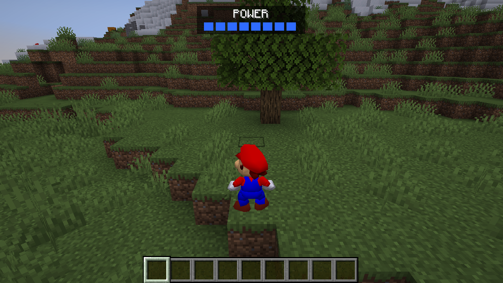 | 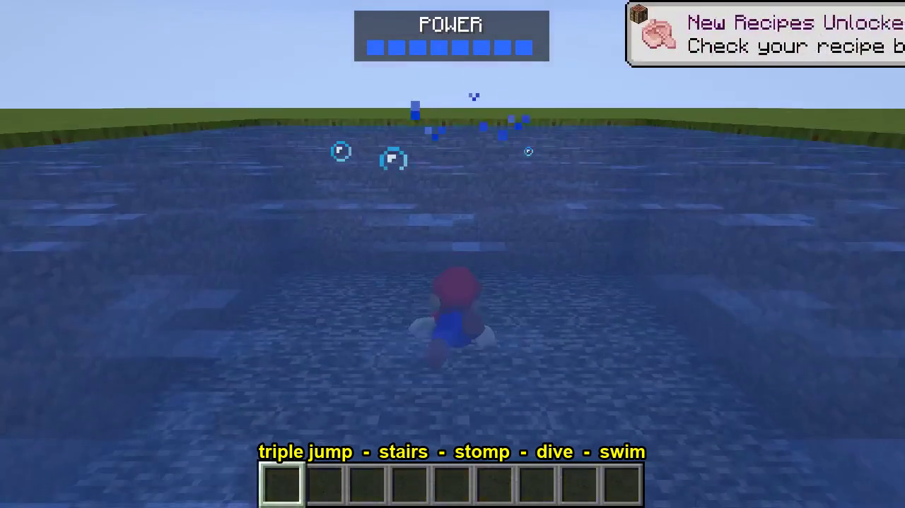 |

### Combat with Minecraft mobs
- Punches, kicks, dives and ground pounds hurt mobs. The ground pound hits everything around you.
- Landing on a mob **stomps** it and bounces Mario, Goomba-style.
- Taking damage plays Mario's SM64 knockback.
- The **power meter** mirrors your hearts.

### The original soundtrack, live from your ROM
SM64's own sequencer plays the music from the ROM's sequence and soundbank data: the real N64 soundtrack, generated
live. In **Auto** mode the track follows where you are:

| Where | Track |
|---|---|
| Grassland, daytime | Bob-omb Battlefield |
| Swimming / underwater | Dire, Dire Docks |
| Deep underground | Cave Dungeon (Hazy Maze Cave) |
| Covered but shallow (houses) | Inside the Castle Walls |
| Snowy biomes | Snow Mountain |
| Deserts, the Nether | Lethal Lava Land |
| Night | Haunted House |
| The End | Koopa's Road |
| Ender Dragon / Wither / Warden nearby | Koopa's Theme (Bowser battle) |

You can also pin any of 20 tracks, including Slider, Ultimate Koopa, Metallic Mario, Staff Roll and File Select.
The track name pops up above the hotbar when the music changes. Mario's voice ("Wahoo!", "Here we go!") and every sound
effect come from the same engine.

### Gamepad support
- Xbox-style (XInput) controllers work through GLFW's standard mapping.
- Tested with a GameSir G7 SE.
- The left stick is truly analog, as on the N64.
- The right stick turns the camera.

### Shader support
- Works with **Iris** (tested with Complementary Reimagined).
- Mario gets the pack's lighting.
- Mario keeps his face textures and **casts real shadows**.

| Shader lighting + textures | Shadows |
|---|---|
| 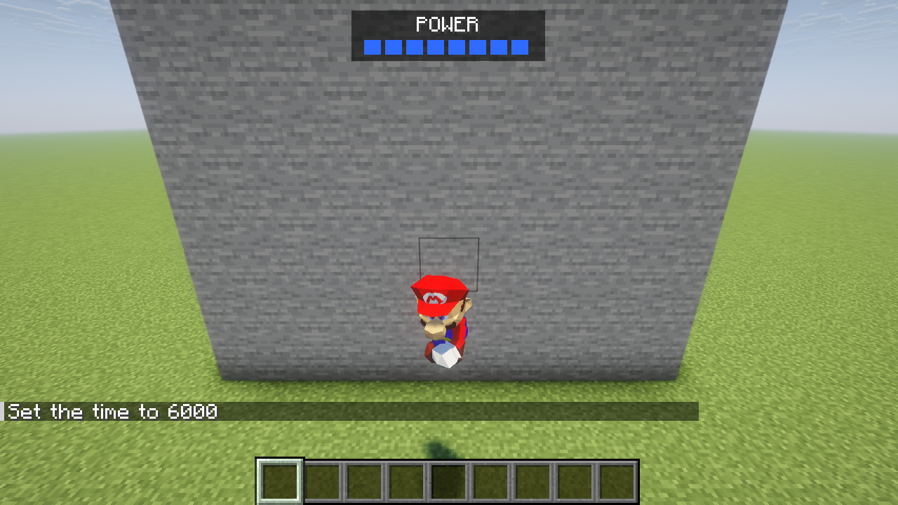 | 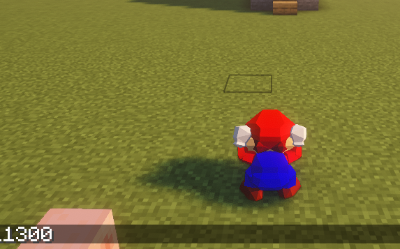 |

### In-game help and settings
| Controls card (keyboard) | Controls card (gamepad) |
|---|---|
| 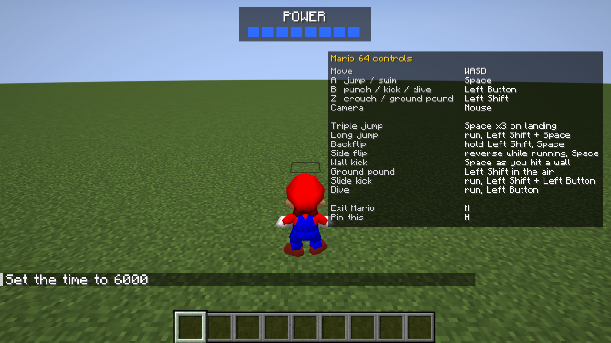 | 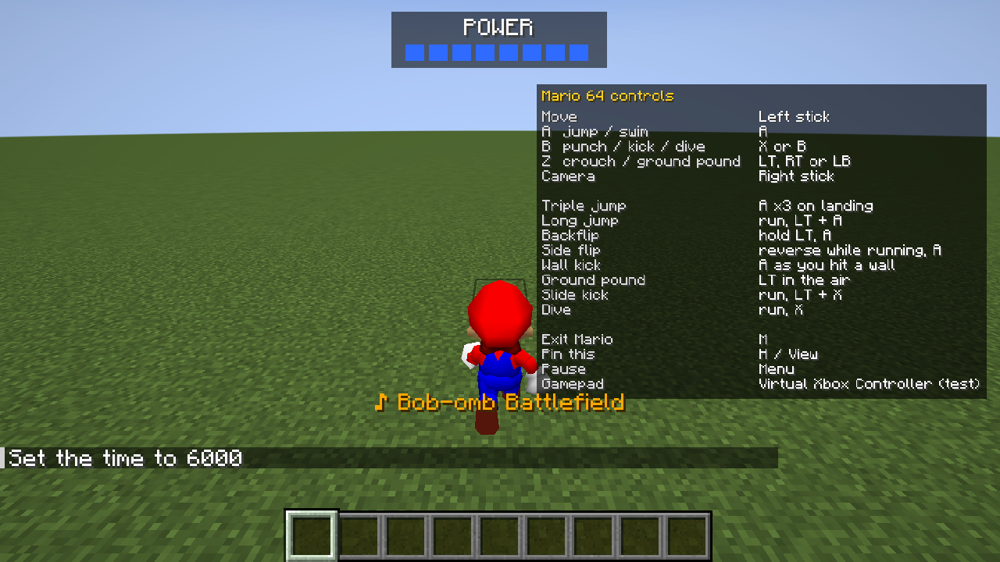 |

| Key Binds section | Mario 64 Settings |
|---|---|
| 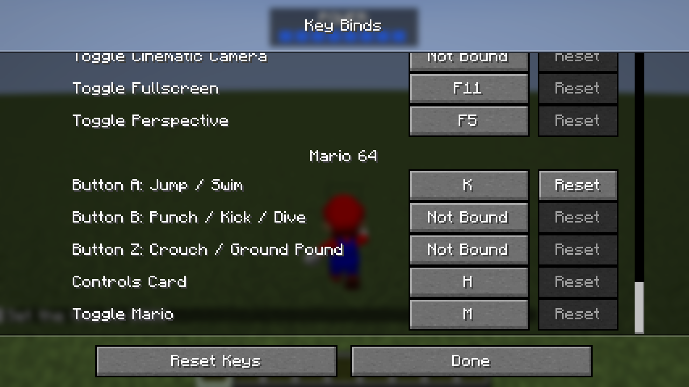 | 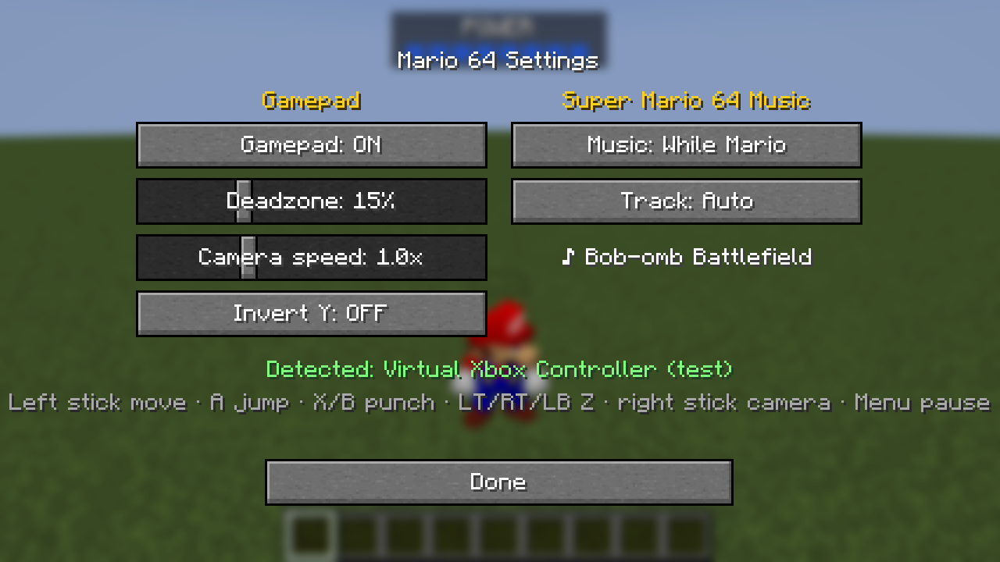 |

---

## How it works

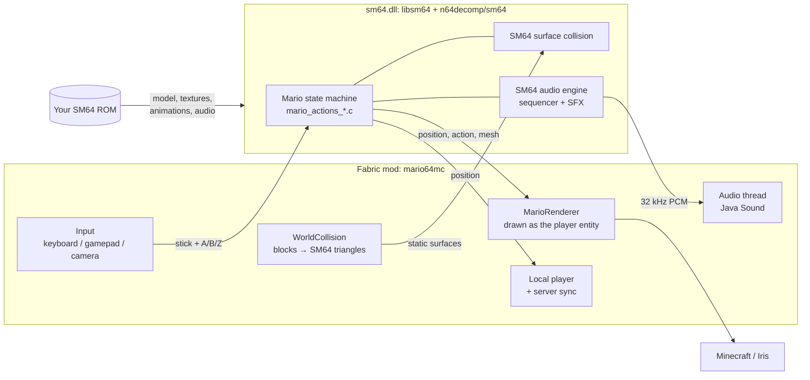

**1. The real game code as a library.**
- [libsm64](https://github.com/libsm64/libsm64) compiles Mario's code from the SM64 decompilation into a shared library:
  `mario.c`, `mario_actions_*.c`, `mario_step.c`, surface collision, animation and the audio engine.
- At startup it reads Mario's model, textures, animations and sound data out of your ROM. This project adds one small
  patch ([`patches/libsm64-music-volume.patch`](patches/libsm64-music-volume.patch)) so music has its own volume
  control, separate from sound effects.

**2. Java ↔ native.**
- The mod calls the library through **JNA** direct mapping ([`LibSM64.java`](mod/src/main/java/dev/mario64mc/sm64/LibSM64.java)).
  Minecraft already ships JNA, so there's no extra dependency.
- C structs (inputs, Mario state, geometry buffers, surfaces) are laid out by hand in off-heap memory.

**3. A 30 Hz SM64 tick inside Minecraft's frame loop.**
- SM64 runs at 30 ticks per second; Minecraft at 20 ticks and any frame rate.
- [`MarioController`](mod/src/main/java/dev/mario64mc/MarioController.java) advances SM64 on a fixed 30 Hz accumulator
  from the start of each rendered frame.
- It interpolates Mario's position and mesh between the last two SM64 ticks, then places the Minecraft player there
  *before* the camera is set up, so the third-person camera follows Mario smoothly.
- **Units:** 1 block = 100 SM64 units, so Mario (~160 units tall) is 1.6 blocks.
- **Floating origin:** the SM64 coordinates are relative to an origin that re-centres as Mario travels. Minecraft
  coordinates would overflow SM64's integers, and its water level is a 16-bit value.

**4. Blocks → SM64 collision.**
- [`WorldCollision`](mod/src/main/java/dev/mario64mc/WorldCollision.java) scans a 17×14×17-block box around Mario
  whenever he enters a new block (and every ⅓ s anyway).
- It emits only the exposed faces of each block's collision boxes as triangles, wound so their normals match SM64's
  `(v2−v1)×(v3−v2)` convention.
- **Special cases:**
  - stairs become ramps;
  - short boxes get no walls, so they act as step-ups;
  - lava and magma become burning floors;
  - every column also gets the first floor below it (up to 64 blocks down), or a fallback floor. In SM64 "no floor"
    acts as an invisible wall, so Mario could never walk off a cliff without one.
- A rebuild takes about 1 ms.

**5. Physics owns the player.**
- While you're Mario, vanilla movement is skipped and the player's position *is* Mario's.
- The integrated server would otherwise judge Mario's moves against Steve's 0.6×1.8 hitbox and snap him back
  ("moved wrongly"). So in single-player the mod marks the Mario player `noClip` only while the server checks his
  movement packets.
- Vanilla fall damage is off because SM64 handles falls itself.

**6. Rendering.**
- libsm64 outputs a triangle mesh each tick.
- SM64 shades Mario as `mix(vertexColour, texture, textureAlpha)`, so the mod draws the mesh twice:
  1. a flat-coloured pass;
  2. the ROM texture atlas alpha-blended on top, nudged a fraction of a unit along the normals (eyes, cap logo,
     buttons, moustache).
- Mario is drawn **as the local player entity**, from inside Minecraft's entity renderer. That's why shader mods treat
  him like any mob: lit by the pack, and drawn into its shadow pass.

**7. Sound.**
- A dedicated audio thread ticks SM64's sound engine and streams 32 kHz stereo PCM to Java Sound.
- All libsm64 audio calls are queued onto that thread.
- Music follows Minecraft's *Music* slider; Mario's voice and SFX follow *Players*.
- Minecraft's own music pauses while SM64 music plays.

**8. Input.**
- **Keyboard / mouse:** Minecraft's movement keys form the analog stick, relative to the camera direction.
  Jump/Attack/Sneak are A/B/Z unless you bind dedicated keys.
- **Gamepad:** read through GLFW's gamepad API with a radial deadzone, so a half tilt really is half.
- **FPS limiter:** gamepad use is reported to Minecraft's *Inactivity FPS Limiter*. Otherwise playing on a controller
  for a minute would trigger the "AFK" 30 FPS cap.

---

## Requirements
| | |
|---|---|
| Minecraft | **Java Edition 1.21.4** |
| Mod loader | [Fabric Loader](https://fabricmc.net/use/installer/) 0.16.10 or newer |
| Library mod | [Fabric API](https://modrinth.com/mod/fabric-api/versions?g=1.21.4) for 1.21.4 (tested 0.119.4) |
| Game files | Your own **Super Mario 64 (USA)** ROM, `.z64`, SHA1 `9bef1128717f958171a4afac3ed78ee2bb4e86ce` |
| OS | **Windows 10/11 x64** (tested). Linux and macOS should work with `libsm64.so` / `.dylib`, but are untested. |
| To build sm64.dll | Git, Python 3, and a MinGW gcc: [w64devkit](https://github.com/skeeto/w64devkit/releases) (portable, easiest) or MSYS2 |
| Optional | A gamepad (Xbox-style), [Sodium](https://modrinth.com/mod/sodium) + [Iris](https://modrinth.com/mod/iris) for shaders |

---

## Installation

### 1. Install Fabric for 1.21.4
Run the [Fabric installer](https://fabricmc.net/use/installer/), choose **Client**, Minecraft **1.21.4** and the latest
loader, then click *Install*. This creates a **fabric-loader-1.21.4** installation in the Minecraft Launcher.

> **Tip:** to keep the mod separate from your other worlds and mods, edit that installation in the launcher and set a
> separate **Game directory**, e.g. `%APPDATA%\.minecraft\mario64`. All the paths below are then inside that folder.

### 2. Add the mods
Put these in the game directory's `mods` folder:
- **Fabric API** for 1.21.4 ([Modrinth](https://modrinth.com/mod/fabric-api/versions?g=1.21.4))
- **`mario64mc-0.1.0.jar`** from this repo's [**Releases**](https://github.com/Zckyy/mario64-in-minecraft/releases)

### 3. Build `sm64.dll` (one command)
`sm64.dll` contains compiled Nintendo code, so it isn't distributed. Build it yourself:

1. Install [Git for Windows](https://git-scm.com/download/win) and [Python 3](https://www.python.org/downloads/).
2. Download [w64devkit](https://github.com/skeeto/w64devkit/releases) (`w64devkit-x64-*.7z.exe`) and extract it, e.g. to `C:\w64devkit`.
3. Open **Git Bash** in this repository's folder and run:

```bash
PATH="/c/w64devkit/bin:$PATH" bash scripts/build-libsm64.sh
```

The script clones libsm64 at the tested commit, applies the music-volume patch, fetches Mario's geometry sources from
n64decomp/sm64 and compiles. The result is `build/libsm64/dist/sm64.dll`.

### 4. Add the DLL and your ROM
Create `config\mario64\` inside the game directory and put two files there:

```
<game directory>\
├─ mods\
│  ├─ fabric-api-0.119.4+1.21.4.jar
│  └─ mario64mc-0.1.0.jar
└─ config\
   └─ mario64\
      ├─ sm64.dll            ← from step 3
      └─ baserom.us.z64      ← your Super Mario 64 (USA) ROM, renamed
```

### 5. Play
1. Launch the **fabric-loader-1.21.4** installation.
2. Open a **single-player** world.
3. Press **M**.

A controls card appears for 8 seconds; press **H** to pin it. Press **M** again to turn back into Steve.

---

## Controls

### Keyboard and mouse
| Key | SM64 |
|---|---|
| **M** | Become Mario / back to Steve |
| W A S D | Analog stick (relative to the camera) |
| Mouse | Camera (third person) |
| Space (*Jump*) | **A**: jump, swim |
| Left click (*Attack*) | **B**: punch, kick, dive |
| Left Shift (*Sneak*) | **Z**: crouch, ground pound |
| **H** | Pin / hide the controls card |

Everything is rebindable in **Options → Controls → Key Binds → Mario 64**. Mario's A/B/Z start *unbound*, which means
"use Minecraft's Jump / Attack / Sneak key". Minecraft lets each key drive only one binding, so defaulting them to
Space/click/Shift would break normal jumping when you're not Mario.

### Gamepad (Xbox layout)
| Button | SM64 |
|---|---|
| Left stick | Analog stick (half tilt walks, full tilt runs) |
| Right stick | Camera |
| A | **A** |
| X or B | **B** |
| LT, RT or LB | **Z** |
| Menu | Pause |
| View | Pin / hide the controls card |

### Moves
| Move | How |
|---|---|
| Triple jump | Jump three times, each right as you land, while running |
| Long jump | Run, then **Z + A** |
| Backflip | Hold **Z** standing still, then **A** |
| Side flip | Run, reverse direction, then **A** while skidding |
| Wall kick | **A** just as you hit a wall mid-jump |
| Ground pound | **Z** in the air |
| Slide kick | Run, then **Z + B** |
| Dive | Run, then **B** |

---

## Settings
**Options → Controls → Mario 64 Settings…** (saved to `config/mario64/mario64.json`):

| Setting | Default | |
|---|---|---|
| Gamepad | On | Use a connected Xbox-style controller |
| Deadzone | 15 % | Radial stick deadzone |
| Camera speed | 1.0× | Right-stick camera speed (1.0 = 180°/s) |
| Invert Y | Off | Invert right-stick vertical |
| Music | While Mario | `While Mario`, `Always` (even as Steve), or `Off` |
| Track | Auto | `Auto` (follows where you are) or any of 20 SM64 tracks |

The screen also shows which controller was detected and the track that's playing.

---

## Shaders
1. Install [Sodium](https://modrinth.com/mod/sodium/versions?g=1.21.4) and [Iris](https://modrinth.com/mod/iris/versions?g=1.21.4) for 1.21.4 (tested: Sodium 0.6.13, Iris 1.8.8).
2. Put a shader pack (tested: [Complementary Reimagined](https://modrinth.com/shader/complementary-reimagined) r5.9.3) in `shaderpacks/`.

In game, **O** opens the shader list and **K** toggles shaders. Mario is lit by the pack and casts shadows. As with
Steve, he isn't drawn in first person.

---

## Building from source

```bash
# 1. the native library (see Installation step 3)
PATH="/c/w64devkit/bin:$PATH" bash scripts/build-libsm64.sh

# 2. the mod (JDK 21)
cd mod
./gradlew build                 # → mod/build/libs/mario64mc-0.1.0.jar
```

For the dev client, put `sm64.dll` and `baserom.us.z64` in `mod/run/config/mario64/`, then run `./gradlew runClient`.

**Technical stack:**
- Minecraft 1.21.4
- Yarn 1.21.4+build.8
- Fabric Loader 0.16.10
- Fabric API 0.119.4
- Loom 1.10
- Gradle 8.14
- Java 21
- libsm64 @ `fd11813`

---

## Automated in-game tests
Each test opens a lab world in the dev client and becomes Mario. It drives scripted or virtual-gamepad input that
*reacts to Mario's actual SM64 action state*, since moves like the wall kick need a fresh button press within a
2-frame window. It then logs `MARIO64TEST` lines (SM64 action IDs, positions, speeds, mob HP, `RESULT …=PASS|FAIL`)
and saves screenshots to `mod/run/screenshots/`.

| Command (in `mod/`) | Checks |
|---|---|
| `./gradlew runAutotest` | Hills: walk, jumps, ledge grab/climb, punch, ground pound |
| `./gradlew runShow` | Flat course: triple jump, stairs, stomp + bounce, dive, swim |
| `./gradlew runTech` | Long jump distance, wall kick |
| `./gradlew runFlips` | Backflip, side flip, slide kick |
| `./gradlew runGamepad` | Real pad detection, deadzone, analog walk vs run, right-stick camera, pad buttons, settings screens |
| `./gradlew runControls` | Controls card, rebinding A → K without breaking vanilla Jump, Key Binds screen |
| `./gradlew runMusic` | The right track for grass / cave / water / End, audible output, Music slider silences it |
| `./gradlew runSoak` | 3 minutes on a virtual gamepad: FPS, heap and per-part timings every 5 s |

**Options:**
- Add `-Pshaders` to any run to load Sodium + Iris with a shader pack from `tools/shaders/`, which you download yourself.
- `MARIO64_TIME=11300` gives long shadows.

**Measured costs** (RTX 5070 Ti, shaders on):
- SM64 tick ≈ 0.2 ms;
- collision rebuild ≈ 1 ms;
- drawing Mario ≈ 0.17 ms per frame;
- flat memory over the 3-minute soak.

---

## Troubleshooting
| Symptom | Fix |
|---|---|
| Red chat message *"put sm64.dll and your own … ROM … in …"* | Both files must be in `<game dir>/config/mario64/`, the ROM named exactly `baserom.us.z64` |
| *"Mario 64 failed to start: UnsatisfiedLinkError … sm64_set_music_volume"* | Your `sm64.dll` was built without the patch. Rebuild with `scripts/build-libsm64.sh` |
| *"Mario needs solid ground under you to spawn"* | Stand on a block (not in the air or water) and press M |
| Mario's model looks wrong or garbled | Use the **US** ROM (`.z64`, big-endian). Check the SHA1 above. |
| No music | Check **Music** isn't `Off` in Mario 64 Settings and Minecraft's Music slider isn't at 0 |
| FPS drops to 30 after a minute | Fixed for gamepads in 0.1.0. On keyboard it's Minecraft's *Inactivity FPS Limit*: Options → Video Settings |
| Doesn't work on a server | Single-player only (see Limitations) |

---

## Limitations
- **Single-player only.**
  - The mod relies on the integrated server trusting Mario's movement.
  - On a multiplayer server you'd be checked against Steve's hitbox, and other players would still see Steve.
- **Other platforms:** only Windows x64 and the US ROM have been tested.
- **Block shapes:** curved and complex blocks are approximated by their collision boxes. Only straight bottom stairs
  become ramps.
- **No SM64 objects:** coins, stars, caps and enemies aren't brought over. It's Mario, his moveset, his sounds and his
  music in Minecraft's world.

---

## Project layout
```
mod/                         Fabric mod (Java 21, Gradle)
  src/main/java/dev/mario64mc/
    sm64/LibSM64.java        JNA bindings for libsm64
    MarioController.java     30 Hz SM64 tick, input, floating origin, water, health, attacks
    WorldCollision.java      Minecraft blocks → SM64 collision triangles
    MarioRenderer.java       Draws the libsm64 mesh as the player entity (two-pass decals)
    MarioAudio.java          SM64 audio thread (Java Sound), command queue, music/SFX volume
    MarioMusic.java          Soundtrack: track picker and "Auto" by place/biome/dimension
    MarioGamepad.java        GLFW gamepad, deadzone, inactivity-limiter keep-awake
    MarioControls.java       Key Binds section and on-screen controls card
    MarioSettingsScreen.java Options → Controls → Mario 64 Settings…
    MarioConfig.java         config/mario64/mario64.json
    AutoTest.java            In-game automated test scenarios
    mixin/                   Player movement, rendering, input and server-trust hooks
patches/                     libsm64 patch (separate music volume)
scripts/build-libsm64.sh     Builds sm64.dll from libsm64 + the decomp sources
docs/media/                  Screenshots and clips used in this README
MODLOG.md                    Development journal: every decision, measurement and gotcha
```

---

## Credits and license
- **[n64decomp/sm64](https://github.com/n64decomp/sm64)**: the Super Mario 64 decompilation that makes all of this possible.
- **[libsm64](https://github.com/libsm64/libsm64)**: Mario as a library (jaburns and contributors).
- **[FabricMC](https://fabricmc.net/)**: Fabric Loader, Fabric API, Loom and Yarn.
- Tested alongside **[Sodium](https://github.com/CaffeineMC/sodium)**, **[Iris](https://github.com/IrisShaders/Iris)** and **[Complementary Reimagined](https://www.complementary.dev/)**.
- Made by **[Zckyy](https://github.com/Zckyy)**. The code, tests and docs were written with **Claude (Anthropic AI)**,
  and every feature was verified in the running game.

The code in this repository is released under the [MIT License](LICENSE). **Super Mario 64 and all of its characters,
assets, sounds and music are © Nintendo.** None of them are included here. This is an unofficial fan project, not
affiliated with or endorsed by Nintendo, Mojang or Microsoft. Please support the official releases.
